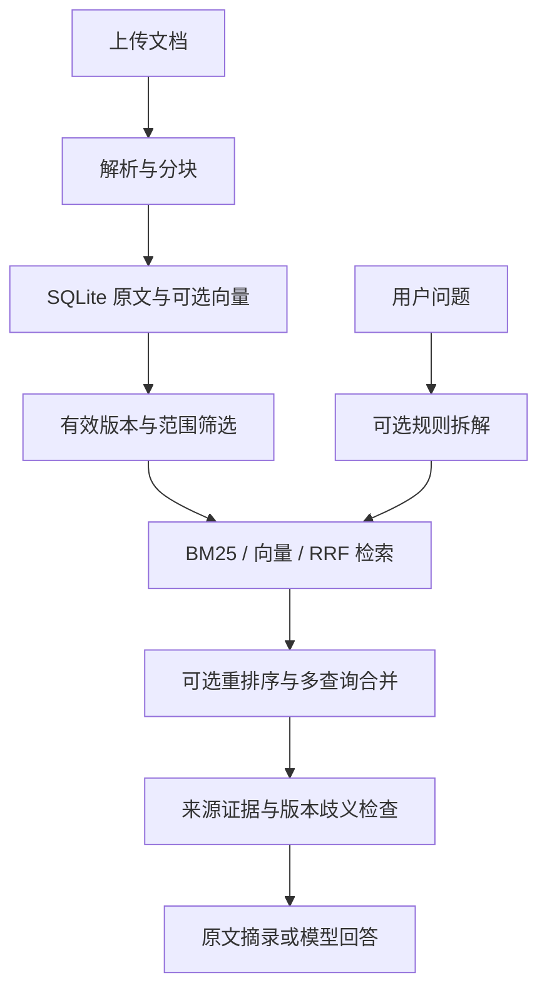

# 知页 · RAG 知识库问答

面向 LLM 应用开发学习的 Python 项目。导入企业文档，检索证据，查看来源；配置模型接口后，基于证据生成回答。默认无需 API 密钥即可运行关键词检索演示。



评测入口：[检索](docs/public-evaluation.md) · [实际回答](docs/public-answer-evaluation.md) · [问题拆解](docs/decomposition-analysis.md) · [干净环境复现](docs/reproduction.md)。上传与后续维护见 [GitHub 使用说明](docs/github.md)。

## 运行

推荐 Python 3.12。首次下载到新目录后，在项目根目录执行以下命令；已有虚拟环境无需重建。基础版使用 CPU 关键词检索，无需 PyTorch、GPU 或模型 API 密钥。

```powershell
python -m venv .venv
.\.venv\Scripts\python.exe -m pip install -r requirements-repro-win-py312.txt
.\.venv\Scripts\python.exe -m uvicorn app.main:app --host 127.0.0.1 --port 8000
```

浏览器访问 http://127.0.0.1:8000 ，点击“导入演示员工手册”，然后提问“北京出差住宿报销上限是多少？”。API 文档在 http://127.0.0.1:8000/docs 。也可以运行 `powershell -ExecutionPolicy Bypass -File .\start.ps1`。停止服务按 Ctrl+C。

上面的固定依赖已在 Windows x64 / Python 3.12.10 的独立环境验证，包含基础应用与测试依赖。其他平台可先用 `requirements-dev.txt` 安装版本范围内的依赖；Linux / macOS 尚未实测。新环境默认不共享全局库；当前电脑原有 `.venv` 共享全局 GPU PyTorch，是本机配置，不是运行前提。

需要配置时，再复制 `.env.example` 为 `.env`；已有 `.env` 请直接编辑，避免覆盖。示例中的模型与 API 配置默认留空，缓存和数据库使用项目内相对路径。基础 CPU 模式不填写 `EMBEDDING_MODEL` 和 `RERANKER_MODEL`；若配置了这些字段，即使选择 BM25，导入也会计算向量。

无 API、无模型文件的完整复现验证：

```powershell
.\.venv\Scripts\python.exe scripts/verify_reproduction.py
```

该命令要求独立的基础环境，检查固定依赖，然后将代码复制到临时目录，运行测试、HTTP 验证、服务重启持久化和公开题集 BM25 评测。输出默认保存到 `reports/reproduction.json`，已有文件拒绝覆盖。本机实测 **76 项通过、1 项可选模型测试跳过**，详见 [复现记录与操作说明](docs/reproduction.md)。原 GPU 环境的 77 项测试结果属于另一套环境。

## 已实现的功能

- UTF-8 / GB18030 / 带 BOM 的 UTF-16 文本与 Markdown 导入；文字型 PDF 导入并保留页码。
- 按标点边界切分，700 字符窗口、100 字符重叠；SHA-256 内容去重。
- 中文二元字符 BM25 关键词检索；可选本地向量余弦检索和 RRF 混合检索；可按请求开启本地 Cross Encoder 重排序。
- 可选规则式复合问题拆解：分别检索各子问题，轮流合并证据，并展示实际子问题与来源对应关系。
- SQLite 保存文档、片段与可选向量，支持重启持久化与文档级联删除。
- 所属手册、版本、生效日期、适用范围及有效状态管理；有效版本筛选、版本歧义提示与归档原文查看。
- 原文摘录和模型生成两种明确标识的回答模式；展示文件名、片段或页码。
- 模型回答引用编号检查；无证据时不调用模型；调用错误明确返回，不伪装为成功回答。
- 本地页面、FastAPI API、自动化测试、独立检索评测，以及带检查点的回答与拒答评测。

## 文档版本与冲突处理

上传前可展开“本次上传的版本信息”；已有文件点击“版本”补充或修改。系统按同一手册、同一范围的已生效日期筛选，排除归档和未来版本；日期缺失、同日多版或范围不明确时，展示候选资料并暂停模型生成，即使只取 Top-1 也不会隐去其他候选。

该功能依赖正确填写的元信息，不从文件名或上传时间猜测版本，也没有自动识别任意条款矛盾。未标注的原始文件需要先补充信息。旧版仍可点击“原文”查看；原数据库自动增加字段并保留文本与向量。

[使用规则与演示步骤](docs/document-versions.md) 配有 `examples/versions/` 的三份虚构手册，演示 500 元旧规、600 元新版和同日 700 元待核实版本。版本专项 13 项、当前全部 77 项自动化测试；自动化验证不调用付费 API。

## 配置真实模型问答

复制 `.env.example` 为 `.env`，填写支持 `/chat/completions` 的接口：

```dotenv
LLM_BASE_URL=https://你的模型服务/v1
LLM_API_KEY=你的密钥
LLM_MODEL=服务商提供的模型名称
```

本地模型服务不需要密钥时可以留空 `LLM_API_KEY`。重启服务后生效。检索到的片段会发送给配置的服务，请选择适合文档保密要求的服务。密钥仅由后端读取，`.env` 不应提交版本控制。

## 开启 GPU 语义与混合检索

这一步需要额外下载模型。建议先跑通关键词版本。没有 GPU 时可将 `EMBEDDING_DEVICE` 和 `RERANKER_DEVICE` 设为 `cpu`，仍需要模型依赖、权重与推理时间；CPU 模型推理未在本轮干净环境验证。

```powershell
.\.venv\Scripts\python.exe -m pip install -r requirements-models.txt
```

在 `.env` 中加入：

```dotenv
EMBEDDING_MODEL=BAAI/bge-small-zh-v1.5
EMBEDDING_DEVICE=cuda
HF_HOME=D:/RAG/data/models
```

首次导入时会加载模型，需要联网下载或提供模型本地路径。开启后页面增加向量检索和混合检索选项。Sentence Transformers 自动批量编码，模型与张量可使用 RTX 4060。BGE 中文模型的查询会加上推荐的检索指令，文档原文不加指令。

推荐先下载模型并验证 GPU，避免首次上传文档时才等待模型下载：

```powershell
$env:HF_HOME = 'D:/RAG/data/models/cache'
.\.venv\Scripts\python.exe scripts/prepare_model.py --device cuda
```

脚本从 Hugging Face 读取模型版本，将固定提交的模型文件下载到 `data/models/模型名/提交号/`，输出实际维度、设备和 `EMBEDDING_MODEL` 配置。把输出路径填写到 `.env`，可以在后续运行时直接加载本地模型。`preparation.json` 保存下载的仓库、提交号及 GPU 验证信息，不包含密钥。

已有资料或切换模型时，先停止服务和上传，再运行：

```powershell
.\.venv\Scripts\python.exe scripts/reindex.py
```

它先备份数据库，再计算全部向量，最后在一次事务中更新索引，保留文档 ID、原文和来源；中途失败不会提交半份索引。备份位于 `data/knowledge.before-reindex-时间戳.db`。索引完成后重新启动服务；不要在重建过程中运行另一个写入数据库的进程。

当前向量检索使用 SQLite 保存向量并在内存中精确计算余弦相似度，适合小型演示。它不是 ANN 向量数据库；文档较多时应迁移到 Qdrant / pgvector 等，并设计批量索引任务。

## 可选本地重排序

重排序先从当前检索模式召回更多片段，再把问题与每个候选片段一起交给 Cross Encoder 打分，最后取所选的来源数。它只调整候选池内的顺序，不能补回未召回的资料，也不是幻觉检测器。

使用已安装的 `requirements-models.txt` 依赖，准备 BGE-reranker-base：

```powershell
.\.venv\Scripts\python.exe scripts/prepare_reranker.py --device cuda
```

脚本下载固定提交的 safetensors 权重与分词器，保存到 `data/models/`，实际运行评分并验证设备。将输出的 `RERANKER_MODEL` 本地路径填入 `.env`，同时配置：

```dotenv
RERANKER_DEVICE=cuda
RERANKER_CANDIDATES=10
```

重启服务并刷新页面后，提问区会出现“重排序”复选框，默认不勾选。配置模型只代表功能可用；每次请求需要显式开启。更换重排序模型不需要重建文档向量。

`/api/search` 和 `/api/chat` 都接受以下参数：

```json
{"question":"去首都跑业务住酒店，一晚上最多能报多少钱？","mode":"hybrid","top_k":3,"rerank":true}
```

默认从 10 条候选中选取前 K 条；候选数可在 10–100 之间配置，实际不足时使用现有候选。返回来源保留 `score` 检索分数，并增加 `rerank_score`，引用编号按新顺序生成。两个分数都不是答案置信度。未配置模型却请求重排序时会明确报错，不会静默退回原排名。

模型在本地运行，不产生模型 API 费用，但需要额外下载、显存和推理时间。使用 FP32、批大小 8，问题与片段合计最多 512 Token；超长输入会截断，可能丢失末尾证据。没有设置重排序分数拒答阈值。

仅比较检索，不调用生成 API：

```powershell
# 比较脚本固定使用10条候选，先诊断dev：
.\.venv\Scripts\python.exe scripts/compare_reranking.py --split dev
# 查看完整基线：
.\.venv\Scripts\python.exe scripts/compare_reranking.py --split all
```

结果包含开关前后的 Top-1/3/5 完整证据命中率、候选池覆盖、逐题变化和预热后耗时，保存到 `reports/reranking.json`、`reports/reranking.md`。

本机 60 题合成数据的一次实测：三种方式的完整证据命中率@3 均未提高；混合检索 MRR@3 从 0.906 提升到 0.934，但取前 5 条的耗时中位数从 9.37 ms 增加到 91.15 ms。向量检索的一个口语问题改善，同时一个多证据问题退步。故目前保留可选、默认关闭，不能声称开启后准确率一定提高。完整结果与具体案例见 [重排序评测报告](docs/reranking.md)。

## 可选问题拆解

页面勾选“问题拆解”，或给 `/api/search`、`/api/chat` 增加 `"decompose": true`。默认关闭；普通单问题通常保持原检索。规则识别问号、分号和“另外”等显式分句，最多拆成三个子问题，不额外调用大模型，不补写省略的主语或条件。

原问题和子问题分别运行所选检索；启用重排序时分别重排，然后轮流选取子问题证据，由原问题补充，按片段 ID 去重。最终来源总数仍受 `top_k` 限制，版本与范围筛选先于所有检索。来源分数属于选中它的查询，合并结果没有跨查询统一分数。页面可展开查看实际子问题，以及每条来源对应的查询。

在固定的 24 道新问法上（12 道跨章节、6 道单问题、6 道缺项），相同 Top-3 下完整证据命中如下。仅运行本地检索，重排序关闭：

| 检索方式 | 拆解关闭 | 拆解开启 |
| --- | --- | --- |
| BM25 | 10/18（55.6%） | 12/18（66.7%） |
| 向量 | 9/18（50.0%） | 11/18（61.1%） |
| 混合 | 9/18（50.0%） | 13/18（72.2%） |

混合检索的多证据题从 4/12 到 8/12；单问题控制题为 5/6，开关前后相同。混合检索有 5 题改善、1 题退步，耗时中位数从 18.59 ms 到 38.39 ms。6 道缺项题仍全部召回资料；这次没有重新调用模型，不能宣称回答准确率提高或幻觉减少。新问法共享旧概念、由同一项目编写，非外部盲测。

另对既有 30 题检查，混合检索总命中仍为 19/24；原先 FM02、FM05 两个失败案例仍未找齐标注证据。故本次是有收益也有退步的可选实验，跨章节漏召回问题尚未彻底解决。方法、逐题记录和局限见 [拆解报告](docs/query-decomposition.md)、[结果分析](docs/decomposition-analysis.md) 和 [既有题回归](docs/decomposition-known.md)。旧回答评测留档不代表这次改动后的模型回答质量。

```powershell
# 本地对照，不调用生成 API；默认使用独立临时数据库：
.\.venv\Scripts\python.exe scripts/compare_decomposition.py
# 与原回答评测工具组合时，可使用 --decompose；实际运行问答会产生 API 费用。
```

## 测试与评测

```powershell
.\.venv\Scripts\python.exe -m pytest -q
.\.venv\Scripts\python.exe scripts/evaluate.py --mode bm25
# 配置并安装语义模型后再做比较：
.\.venv\Scripts\python.exe scripts/evaluate.py --mode hybrid --output reports/hybrid.json
# 使用同一索引比较三种检索，包含换一种说法的问题：
.\.venv\Scripts\python.exe scripts/compare_retrieval.py --top-k 1
# 扩展评测：16 份制度、60 道问题，比较 Top-1/3/5：
.\.venv\Scripts\python.exe scripts/benchmark.py --split all --top-k 1 3 5
# 后续调试只看开发集；无语义模型也能运行 BM25：
.\.venv\Scripts\python.exe scripts/benchmark.py --split dev --modes bm25 --output reports/dev.json --markdown reports/dev.md
```

上述检索评测自动使用临时数据库，不改动实际知识库，不调用生成 API。结果保存到 `reports/`。扩展评测会先校验参考文件与原文证据，输出题集和资料哈希、逐题来源、缺失证据、分组指标及耗时；Markdown 报告默认位于 `reports/benchmark.md`。

`evaluate.py` 使用 10 个原词问题；`compare_retrieval.py` 另外加入 10 个改写问题，比较同一索引的 BM25、向量、混合检索，输出分组命中率、MRR 和预热后耗时。默认对比 Top-1，避免 Top-5 覆盖全部片段而让结果失去区分度。

旧版 `evaluate.py` 和 `compare_retrieval.py` 仅使用一份虚构手册、2 个片段，保留用于快速功能验证。下面的结果来自新的 `benchmark.py`，不能与旧版数据集直接比较。

扩展评测使用 `evals/corpus/` 的 16 份虚构制度、16 个片段，题集位于 `evals/benchmark.json`：16 道原词问题、16 道改写问题、8 道适用范围辨析、8 道多证据问题和 12 道无答案问题。dev 26 题，test 34 题，后续调参优先使用 dev。两组共享资料，均为手工合成问题，不是外部盲测。

本机 RTX 4060、BGE-small-zh-v1.5 的一次实测如下。命中率统计全部 **48 道有答案问题**，要求 Top-3 中包含每条标注证据，同时匹配文件名与原文；多证据题只找到其中一条不算完整命中。

| 检索方式 | 全部证据命中率@3 | 平均证据召回率@3 | MRR@3 | 预热后取前 5 条耗时中位数 |
| --- | --- | --- | --- | --- |
| BM25 | 93.8%（45/48） | 94.8% | 0.875 | 4.31 ms |
| 向量 | 97.9%（47/48） | 97.9% | 0.924 | 9.22 ms |
| RRF 混合 | 95.8%（46/48） | 96.9% | 0.896 | 9.26 ms |

test 单独统计时，三种模式的全部证据命中率@3 均为 25/26（96.2%），但漏题不同。详细分组指标、Top-1/3/5 和具体案例见 [评测报告](docs/evaluation.md)。耗时是逐题单次测量，不代表并发性能；随机片段 ID 会影响并列排序，重建索引后个别结果可能变化。

12 道无答案题在三种模式下都返回了片段。这只说明检索层未拒绝召回，不能直接算作模型回答错误：相关条款也可能帮助模型判断“资料未提供”。此检索评测本身不衡量生成回答质量；此数据集短小且人工编写，不能把上述指标写成真实企业问答准确率。

## 真实公开文档评测

另增 FastAPI `0.115.0` 的 6 篇中文教程原文，按 MIT 许可保留来源，切分为 50 个片段；30 道项目编写的问题包含原词、口语改写、适用范围、跨章节多证据和自然缺项各 6 道。dev 10 题，test 20 题。原文逐文件 SHA-256、许可和下载信息均已留档；这是真实文档上的人工题集，并非真实用户日志或外部盲测。

在全部 24 道有答案题上，严格标注的完整证据命中率@3 如下。同次对比共用临时索引，仅运行本地 GPU 检索与重排序，不调用 DeepSeek。

| 检索方式 | 关闭重排序 | 开启重排序 |
| --- | --- | --- |
| BM25 | 91.7%（22/24） | 83.3%（20/24） |
| 向量 | 62.5%（15/24） | 79.2%（19/24） |
| RRF 混合 | 79.2%（19/24） | 83.3%（20/24） |

重排序改善部分排名，也可能将多问题的另一份证据挤出 Top-3。复核还发现一处等价证据漏标：片段表达同一规则，但不含指定原句，仍被严格计分记为未命中。因此这些分数不能直接代表语义失败率，更不代表问答准确率。混合检索开启重排序时也扩大了每路候选数，本次差异包含两者共同效果；默认开关保持关闭。

完整 dev/test、Top-1/3/5、耗时和失败分析见 [公开文档评测报告](docs/public-evaluation.md)，来源及题集见 [数据集说明](evals/public-fastapi/README.md)。6 道无答案题仍召回片段，本次未测生成回答或拒答质量。

```powershell
# 不联网即可校验已附带的原文、许可与标注：
.\.venv\Scripts\python.exe scripts/prepare_public_corpus.py
# 复现同索引的开关对比（需先配置本地 Embedding 和 Reranker）：
.\.venv\Scripts\python.exe scripts/compare_reranking.py --dataset evals/public-fastapi/benchmark.json --corpus evals/public-fastapi/corpus --split all --output reports/public-fastapi.json --markdown reports/public-fastapi.md
```

## 回答忠实度与拒答评测

已使用实际配置的 DeepSeek、混合检索 Top-3，对 28 道问题运行完整问答：8 道条款辨析、8 道多证据、12 道无答案。自动检查引用编号和拒答措辞后，由 Codex 逐题对照实际来源复核；这是单评审，尚无独立人工盲评。

- 16 道有答案题中，15 道完整回答，1 道因漏召回而只回答已知部分，并明确其余信息不足。
- 12 道无答案题均说明无法确定，没有给出缺乏依据的金额、期限、型号等。
- 本次复核未发现无依据事实或引用支持问题，不能据此声称系统幻觉率为零。
- 28 次成功响应报告输入 22,650、输出 5,052，共 27,702 Token；另有一次失败尝试未返回 usage。未按未经核实的单价估算费用，金额以服务商账单为准。

完整方法、逐题复核、关键案例和原始记录见 [回答评测报告](docs/answer-evaluation.md)。原始回答与来源留档在 `docs/answer-run.json`，复核依据和回答哈希在 `docs/answer-review.json`，便于他人重新审阅。

```powershell
# 只检查题目，不调用 API：
.\.venv\Scripts\python.exe scripts/evaluate_answers.py --dry-run
# 实际调用模型，会产生费用；可先少量运行：
.\.venv\Scripts\python.exe scripts/evaluate_answers.py --split dev --limit 3 --output reports/answers-dev.json
# 中断后沿用相同参数续跑，跳过已成功保存的题目：
.\.venv\Scripts\python.exe scripts/evaluate_answers.py --split dev --limit 3 --output reports/answers-dev.json --resume
# 配置重排序模型后，可另外运行开启重排序的回答评测（会产生API费用）：
.\.venv\Scripts\python.exe scripts/evaluate_answers.py --split dev --limit 3 --rerank --output reports/answers-dev-rerank.json
# 只校验并重新生成已留档的离线评审报告，不调用 API：
.\.venv\Scripts\python.exe scripts/report_answers.py
```

回答评测使用独立临时数据库。参考答案不发送给回答模型，未使用额外裁判 API。逐题保存实际回答、来源、耗时和 usage；文件已存在时拒绝覆盖，续跑校验代码、数据和配置指纹。引用编号合法和出现拒答词只是初筛，不能直接当作语义正确率。多数无答案题在资料中明确写了“未规定”，真实场景还需要加入隐含缺项、矛盾信息与对抗问题。

## 公开文档的实际回答与冲突评测

在上述检索基线之外，另对 20 道问题完成单次端到端验证：8 道正常公开文档问题、6 道自然缺项、3 道错误前提，以及 3 个独立虚构冲突场景。使用实际配置的 DeepSeek、混合检索 Top-3，重排序关闭；19 次模型回答、1 次本地版本拦截，使用独立临时库。

- 正常问题 6/8 完整回答；2 道跨章节问题漏证据，只回答已知部分。
- 自然缺项 6/6 正确拒答，没有补造参数、费用或凭据。
- 错误前提题 1/3 完整且来源支持充分；另外 1 道只部分纠正，1 道核心方向正确但额外解释缺少实际引用依据。
- 两个正文冲突场景均说明矛盾；一个版本歧义场景由本地规则拦截，不调用模型。虚构规则不是 FastAPI 官方内容。

这些结论由 Codex 单评审逐题对照实际来源得出，不是独立人工盲评。此次仍发现一处无依据扩展，不能把“引用编号全部有效”写成“没有幻觉”。成功响应共报告 23,717 Token，另有一次失败请求 usage 未知；最终费用以账单为准。

完整回答、引用支持复核、用量和复现命令见 [公开文档回答评测](docs/public-answer-evaluation.md)。历史检索和虚构手册回答记录保留原样。

```powershell
# 只校验这套公开回答题集和独立冲突资料，不调用 API：
.\.venv\Scripts\python.exe scripts/evaluate_answers.py --dataset evals/public-fastapi/benchmark.json --corpus evals/public-fastapi/corpus --annotations evals/public-fastapi/answers.json --suite --dry-run
# 校验已保存的逐题复核并重新生成报告，不调用 API：
.\.venv\Scripts\python.exe scripts/report_public_answers.py
```

## 目录

```text
app/          配置、文档解析、SQLite 存储、检索、模型调用、API
static/       无需构建的中文页面
examples/     虚构演示手册
evals/        虚构制度、公开 FastAPI 原文、来源许可、dev/test 问题与证据
scripts/      模型准备、索引重建、检索评测
docs/         检索与回答评测报告、逐题回答和复核留档
tests/        分块、去重、检索、API、模型接口模拟测试
data/         运行后生成的数据库和可选模型缓存（不提交）
```

## 部署与边界

默认只监听本机。此版本是个人学习项目，未实现登录、租户隔离和生产级权限，不能直接暴露到公网或作为企业生产系统。单文件上限 10 MB，PDF 上限 300 页，不支持 OCR 和表格版式还原。多轮对话、异步索引、流式生成尚未实现。

上传接口只读取上限加 1 字节后校验，但 Web 框架在进入业务处理之前仍可能缓冲 multipart 请求；生产部署需另设反向代理请求体限制。模型引用编号存在性检查不能证明结论真实，仍应核对原文。提示词仅降低文档指令注入风险，不能保证完全阻止。

Docker 基础版可用 `docker build -t zhiye-rag .` 构建，运行示例：

```powershell
docker run --rm -p 127.0.0.1:8000:8000 --env-file .env -v rag-data:/app/data zhiye-rag
```

该镜像不包含本地语义模型依赖。基础摘录演示请省略 `--env-file .env`；配置模型 API 时使用只含 API 配置的独立环境文件，避免带入 Windows 本地模型路径。Docker 部署未在当前电脑验证，本轮验证的是独立 Python 环境。

## 面试讲解与后续路线

先能解释文档切分、BM25、本地 GPU 向量召回、RRF、Cross Encoder 与规则拆解的选择及局限，并根据评测报告讲清楚为什么混合检索或重排序不一定更好、忠实回答为什么也可能不完整。下一步优先复核 dev 的等价证据和分块，分析仍漏证据的子问题，再决定是否调整候选合并；改动后需用新题验证，并对生成结果另做忠实度复核、加入独立人工评审。简历只填写实际实现并测过的功能，所有指标注明资料来源、数据规模和测试条件。
