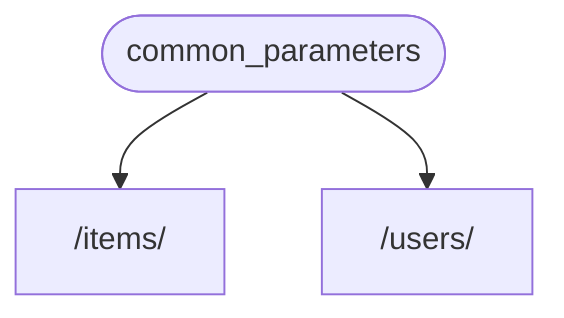

# 回答评测原始记录

模型：`deepseek-flash`；检索：`hybrid`；Top-K：3。
计划 20 题，完成 20 题，错误 0 题。
实际接口 usage 汇总：`{"prompt_tokens": 19221, "completion_tokens": 4496, "total_tokens": 23717, "prompt_cache_hit_tokens": 0, "prompt_cache_miss_tokens": 19221}`。未按未经核实的单价估算费用，金额以服务商账单为准。

**以下只是机械检查与完整原文记录，不是自动裁判判定的正确率。**
检查范围：引用编号存在性、是否出现拒答措辞。含拒答措辞仍可能夹带编造事实；有引用也不代表引用支持结论。
参考答案和原文标注仅用于离线评审，未发送给生成模型。所有记录使用临时知识库，未修改应用知识库。

## FL01（dev / literal）

问题：查询字符串位于 URL 的什么位置？多个键值对用什么符号分隔？

参考要求：位于 ? 后，以 & 分隔。

### 实际回答

查询字符串位于 URL 的 `?` 之后；多个键值对之间用 `&` 分隔 [1]。

机械检查：`{"citation_ids": [1], "invalid_citation_ids": [], "has_citation": true, "citation_ids_valid": true, "refusal_marker_detected": false, "semantic_verdict": "pending_review"}`。

证据完整召回：True；耗时：1880.2 ms。

回答路径：`llm`；模型调用：是。

### 实际来源（仅 llm 路径发送给模型）

#### [1] query-params.md / 片段 1

# 查询参数

声明的参数不是路径参数时，路径操作函数会把该参数自动解释为**查询**参数。

```Python hl_lines="9"
{!../../../docs_src/query_params/tutorial001.py!}
```

查询字符串是键值对的集合，这些键值对位于 URL 的 `?` 之后，以 `&` 分隔。

例如，以下 URL 中：

```
http://127.0.0.1:8000/items/?skip=0&limit=10
```

……查询参数为：

* `skip`：值为 `0`
* `limit`：值为 `10`

这些值都是 URL 的组成部分，因此，它们的类型**本应**是字符串。

但声明 Python 类型（上例中为 `int`）之后，这些值就会转换为声明的类型，并进行类型校验。

所有应用于路径参数的流程也适用于查询参数：

* （显而易见的）编辑器支持
* 数据<abbr title="将来自 HTTP 请求的字符串转换为 Python 数据类型">**解析**</abbr>
* 数据校验
* API 文档

## 默认值

查询参数不是路径的固定内容，它是可选的，还支持默认值。

上例用 `skip=0` 和 `limit=10` 设定默认值。

访问 URL：

```
http://127.0.0.1:8000/items/
```

与访问以下地址相同：

```
http://127.0.0.1:8000/items/?skip=0&limit=10
```

但如果访问：

```

#### [2] query-params.md / 片段 5

如果只想把参数设为**可选**，但又不想指定参数的值，则要把默认值设为 `None`。

如果要把查询参数设置为**必选**，就不要声明默认值：

```Python hl_lines="6-7"
{!../../../docs_src/query_params/tutorial005.py!}
```

这里的查询参数 `needy` 是类型为 `str` 的必选查询参数。

在浏览器中打开如下 URL：

```
http://127.0.0.1:8000/items/foo-item
```

……因为路径中没有必选参数 `needy`，返回的响应中会显示如下错误信息：

```JSON
{
    "detail": [
        {
            "loc": [
                "query",
                "needy"
            ],
            "msg": "field required",
            "type": "value_error.missing"
        }
    ]
}
```

`needy` 是必选参数，因此要在 URL 中设置值：

```
http://127.0.0.1:8000/items/foo-item?needy=sooooneedy
```

……这样就正常了：

```JSON
{
    "item_id": "foo-item",
    "needy": "sooooneedy"
}
```

#### [3] query-params.md / 片段 2

.0.1:8000/items/
```

与访问以下地址相同：

```
http://127.0.0.1:8000/items/?skip=0&limit=10
```

但如果访问：

```
http://127.0.0.1:8000/items/?skip=20
```

查询参数的值就是：

* `skip=20`：在 URL 中设定的值
* `limit=10`：使用默认值

## 可选参数

同理，把默认值设为 `None` 即可声明**可选的**查询参数：

//// tab | Python 3.10+

```Python hl_lines="7"
{!> ../../../docs_src/query_params/tutorial002_py310.py!}
```

////

//// tab | Python 3.8+

```Python hl_lines="9"
{!> ../../../docs_src/query_params/tutorial002.py!}
```

////

本例中，查询参数 `q` 是可选的，默认值为 `None`。

/// check | "检查"

注意，**FastAPI** 可以识别出 `item_id` 是路径参数，`q` 不是路径参数，而是查询参数。

///

/// note | "笔记"

因为默认值为 `= None`，FastAPI 把 `q` 识别为可选参数。

## FL04（test / literal）

问题：HTTPException 的 detail 只能是 str 吗？还能传哪些数据结构？

参考要求：不限于 str，也可传 dict、list 等可转换为 JSON 的值。

### 实际回答

不是只能传 `str`。资料明确指出，触发 `HTTPException` 时，`detail` 可以传任何能转换为 JSON 的值，不仅限于字符串，还支持 `dict`、`list` 等数据结构，FastAPI 会自动将其转换为 JSON [2]。例如资料中的 404 示例使用了字符串 `"Item not found"` 作为 `detail` [2]。

机械检查：`{"citation_ids": [2], "invalid_citation_ids": [], "has_citation": true, "citation_ids_valid": true, "refusal_marker_detected": false, "semantic_verdict": "pending_review"}`。

证据完整召回：True；耗时：2408.2 ms。

回答路径：`llm`；模型调用：是。

### 实际来源（仅 llm 路径发送给模型）

#### [1] handling-errors.md / 片段 2

xception`

`HTTPException` 是额外包含了和 API 有关数据的常规 Python 异常。

因为是 Python 异常，所以不能 `return`，只能 `raise`。

如在调用*路径操作函数*里的工具函数时，触发了 `HTTPException`，FastAPI 就不再继续执行*路径操作函数*中的后续代码，而是立即终止请求，并把 `HTTPException` 的 HTTP 错误发送至客户端。

在介绍依赖项与安全的章节中，您可以了解更多用 `raise` 异常代替 `return` 值的优势。

本例中，客户端用 `ID` 请求的 `item` 不存在时，触发状态码为 `404` 的异常：

```Python hl_lines="11"
{!../../../docs_src/handling_errors/tutorial001.py!}

```

### 响应结果

请求为 `http://example.com/items/foo`（`item_id` 为 `「foo」`）时，客户端会接收到 HTTP 状态码 - 200 及如下 JSON 响应结果：

```JSON
{
  "item": "The Foo Wrestlers"
}

```

但如果客户端请求 `http://example.com/items/bar`（`item_id` `「bar」` 不存在时），则会接收到 HTTP 状态码 - 404（「未找到」错误）及如下 JSON 响应结果：

```JSON
{

#### [2] handling-errors.md / 片段 3

ample.com/items/bar`（`item_id` `「bar」` 不存在时），则会接收到 HTTP 状态码 - 404（「未找到」错误）及如下 JSON 响应结果：

```JSON
{
  "detail": "Item not found"
}

```

/// tip | "提示"

触发 `HTTPException` 时，可以用参数 `detail` 传递任何能转换为 JSON 的值，不仅限于 `str`。

还支持传递 `dict`、`list` 等数据结构。

**FastAPI** 能自动处理这些数据，并将之转换为 JSON。

///

## 添加自定义响应头

有些场景下要为 HTTP 错误添加自定义响应头。例如，出于某些方面的安全需要。

一般情况下可能不会需要在代码中直接使用响应头。

但对于某些高级应用场景，还是需要添加自定义响应头：

```Python hl_lines="14"
{!../../../docs_src/handling_errors/tutorial002.py!}

```

## 安装自定义异常处理器

添加自定义处理器，要使用 [Starlette 的异常工具](https://www.starlette.io/exceptions/)。

假设要触发的自定义异常叫作 `UnicornException`。

且需要 FastAPI 实现全局处理该异常。

此时，可以用 `@app.exception_handler()` 添加自定义异常控制器：

#### [3] handling-errors.md / 片段 1

# 处理错误

某些情况下，需要向客户端返回错误提示。

这里所谓的客户端包括前端浏览器、其他应用程序、物联网设备等。

需要向客户端返回错误提示的场景主要如下：

- 客户端没有执行操作的权限
- 客户端没有访问资源的权限
- 客户端要访问的项目不存在
- 等等 ...

遇到这些情况时，通常要返回 **4XX**（400 至 499）**HTTP 状态码**。

**4XX** 状态码与表示请求成功的 **2XX**（200 至 299） HTTP 状态码类似。

只不过，**4XX** 状态码表示客户端发生的错误。

大家都知道**「404 Not Found」**错误，还有调侃这个错误的笑话吧？

## 使用 `HTTPException`

向客户端返回 HTTP 错误响应，可以使用 `HTTPException`。

### 导入 `HTTPException`

```Python hl_lines="1"
{!../../../docs_src/handling_errors/tutorial001.py!}

```

### 触发 `HTTPException`

`HTTPException` 是额外包含了和 API 有关数据的常规 Python 异常。

因为是 Python 异常，所以不能 `return`，只能 `raise`。

## FP01（dev / paraphrase）

问题：想查自己的资料，/users/me 却被当成了用户编号 me，两个路由应该怎么排？

参考要求：先声明固定路径 /users/me，再声明 /users/{user_id}。

### 实际回答

应把固定路径 `/users/me` 放在动态路径 `/users/{user_id}` **之前**声明。因为路径操作按顺序匹配，否则 `/users/{user_id}` 会先匹配 `/users/me`，并把 `"me"` 当成 `user_id`。[1][3]

机械检查：`{"citation_ids": [1, 3], "invalid_citation_ids": [], "has_citation": true, "citation_ids_valid": true, "refusal_marker_detected": false, "semantic_verdict": "pending_review"}`。

证据完整召回：True；耗时：2278.0 ms。

回答路径：`llm`；模型调用：是。

### 实际来源（仅 llm 路径发送给模型）

#### [1] path-params.md / 片段 5

c</a>：


同样，还有很多兼容工具，包括多种语言的代码生成工具。

## Pydantic

FastAPI 充分地利用了 <a href="https://docs.pydantic.dev/" class="external-link" target="_blank">Pydantic</a> 的优势，用它在后台校验数据。众所周知，Pydantic 擅长的就是数据校验。

同样，`str`、`float`、`bool` 以及很多复合数据类型都可以使用类型声明。

下一章介绍详细内容。

## 顺序很重要

有时，*路径操作*中的路径是写死的。

比如要使用 `/users/me` 获取当前用户的数据。

然后还要使用 `/users/{user_id}`，通过用户 ID 获取指定用户的数据。

由于*路径操作*是按顺序依次运行的，因此，一定要在 `/users/{user_id}` 之前声明 `/users/me` ：

```Python hl_lines="6  11"
{!../../../docs_src/path_params/tutorial003.py!}
```

否则，`/users/{user_id}` 将匹配 `/users/me`，FastAPI 会**认为**正在接收值为 `"me"` 的 `user_id` 参数。

## 预设值

#### [2] response-model.md / 片段 4

.py!}
```

////

这样，即便我们的*路径操作函数*将会返回包含密码的相同输入用户：

//// tab | Python 3.10+

```Python hl_lines="24"
{!> ../../../docs_src/response_model/tutorial003_py310.py!}
```

////

//// tab | Python 3.8+

```Python hl_lines="24"
{!> ../../../docs_src/response_model/tutorial003.py!}
```

////

...我们已经将 `response_model` 声明为了不包含密码的 `UserOut` 模型：

//// tab | Python 3.10+

```Python hl_lines="22"
{!> ../../../docs_src/response_model/tutorial003_py310.py!}
```

////

//// tab | Python 3.8+

```Python hl_lines="22"
{!> ../../../docs_src/response_model/tutorial003.py!}
```

////

因此，**FastAPI** 将会负责过滤掉未在输出模型中声明的所有数据（使用 Pydantic）。

## 在文档中查看

当你查看自动化文档时，你可以检查输入模型和输出模型是否都具有自己的 JSON Schema：

#### [3] path-params.md / 片段 6

!}
```

否则，`/users/{user_id}` 将匹配 `/users/me`，FastAPI 会**认为**正在接收值为 `"me"` 的 `user_id` 参数。

## 预设值

路径操作使用 Python 的 <abbr title="Enumeration">`Enum`</abbr> 类型接收预设的*路径参数*。

### 创建 `Enum` 类

导入 `Enum` 并创建继承自 `str` 和 `Enum` 的子类。

通过从 `str` 继承，API 文档就能把值的类型定义为**字符串**，并且能正确渲染。

然后，创建包含固定值的类属性，这些固定值是可用的有效值：

```Python hl_lines="1  6-9"
{!../../../docs_src/path_params/tutorial005.py!}
```

/// info | "说明"

Python 3.4 及之后版本支持<a href="https://docs.python.org/3/library/enum.html" class="external-link" target="_blank">枚举（即 enums）</a>。

///

/// tip | "提示"

**AlexNet**、**ResNet**、**LeNet** 是机器学习<abbr title="技术上来说是深度学习模型架构">模型</abbr>。

///

### 声明*路径参数*

使用 Enum 类（`ModelName`）创建使用类型注解的*路径参数*：

## FP04（test / paraphrase）

问题：查不到记录时，在路由调用的小工具函数里抛 HTTPException，后面的业务代码还会执行吗？

参考要求：不会，触发异常后终止请求并向客户端发送 HTTP 错误。

### 实际回答

不会。若在路由调用的工具函数中 `raise HTTPException`，FastAPI 会立即终止请求，不再继续执行路径操作函数中的后续代码，并向客户端返回该 HTTP 错误 [1]。

机械检查：`{"citation_ids": [1], "invalid_citation_ids": [], "has_citation": true, "citation_ids_valid": true, "refusal_marker_detected": false, "semantic_verdict": "pending_review"}`。

证据完整召回：True；耗时：2368.9 ms。

回答路径：`llm`；模型调用：是。

### 实际来源（仅 llm 路径发送给模型）

#### [1] handling-errors.md / 片段 2

xception`

`HTTPException` 是额外包含了和 API 有关数据的常规 Python 异常。

因为是 Python 异常，所以不能 `return`，只能 `raise`。

如在调用*路径操作函数*里的工具函数时，触发了 `HTTPException`，FastAPI 就不再继续执行*路径操作函数*中的后续代码，而是立即终止请求，并把 `HTTPException` 的 HTTP 错误发送至客户端。

在介绍依赖项与安全的章节中，您可以了解更多用 `raise` 异常代替 `return` 值的优势。

本例中，客户端用 `ID` 请求的 `item` 不存在时，触发状态码为 `404` 的异常：

```Python hl_lines="11"
{!../../../docs_src/handling_errors/tutorial001.py!}

```

### 响应结果

请求为 `http://example.com/items/foo`（`item_id` 为 `「foo」`）时，客户端会接收到 HTTP 状态码 - 200 及如下 JSON 响应结果：

```JSON
{
  "item": "The Foo Wrestlers"
}

```

但如果客户端请求 `http://example.com/items/bar`（`item_id` `「bar」` 不存在时），则会接收到 HTTP 状态码 - 404（「未找到」错误）及如下 JSON 响应结果：

```JSON
{

#### [2] handling-errors.md / 片段 7

/concepts/models/#error-handling" class="external-link" target="_blank">`ValidationError`</a> 的子类。

**FastAPI** 调用的就是 `RequestValidationError` 类，因此，如果在 `response_model` 中使用 Pydantic 模型，且数据有错误时，在日志中就会看到这个错误。

但客户端或用户看不到这个错误。反之，客户端接收到的是 HTTP 状态码为 `500` 的「内部服务器错误」。

这是因为在*响应*或代码（不是在客户端的请求里）中出现的 Pydantic `ValidationError` 是代码的 bug。

修复错误时，客户端或用户不能访问错误的内部信息，否则会造成安全隐患。

### 覆盖 `HTTPException` 错误处理器

同理，也可以覆盖 `HTTPException` 处理器。

例如，只为错误返回纯文本响应，而不是返回 JSON 格式的内容：

```Python hl_lines="3-4  9-11  22"
{!../../../docs_src/handling_errors/tutorial004.py!}

```

/// note | "技术细节"

还可以使用 `from starlette.responses import PlainTextResponse`。

#### [3] handling-errors.md / 片段 1

# 处理错误

某些情况下，需要向客户端返回错误提示。

这里所谓的客户端包括前端浏览器、其他应用程序、物联网设备等。

需要向客户端返回错误提示的场景主要如下：

- 客户端没有执行操作的权限
- 客户端没有访问资源的权限
- 客户端要访问的项目不存在
- 等等 ...

遇到这些情况时，通常要返回 **4XX**（400 至 499）**HTTP 状态码**。

**4XX** 状态码与表示请求成功的 **2XX**（200 至 299） HTTP 状态码类似。

只不过，**4XX** 状态码表示客户端发生的错误。

大家都知道**「404 Not Found」**错误，还有调侃这个错误的笑话吧？

## 使用 `HTTPException`

向客户端返回 HTTP 错误响应，可以使用 `HTTPException`。

### 导入 `HTTPException`

```Python hl_lines="1"
{!../../../docs_src/handling_errors/tutorial001.py!}

```

### 触发 `HTTPException`

`HTTPException` 是额外包含了和 API 有关数据的常规 Python 异常。

因为是 Python 异常，所以不能 `return`，只能 `raise`。

## FM01（dev / multi_evidence）

问题：查询参数 q 默认 None，而请求体模型某属性没有默认值，这两项分别是可选还是必填？

参考要求：q 可选；无默认值的模型属性必填。

### 实际回答

查询参数 `q` 默认值为 `None`，因此是**可选参数** [1]；请求体模型中没有默认值的属性是**必填属性** [3]。

机械检查：`{"citation_ids": [1, 3], "invalid_citation_ids": [], "has_citation": true, "citation_ids_valid": true, "refusal_marker_detected": false, "semantic_verdict": "pending_review"}`。

证据完整召回：True；耗时：1977.7 ms。

回答路径：`llm`；模型调用：是。

### 实际来源（仅 llm 路径发送给模型）

#### [1] query-params.md / 片段 2

.0.1:8000/items/
```

与访问以下地址相同：

```
http://127.0.0.1:8000/items/?skip=0&limit=10
```

但如果访问：

```
http://127.0.0.1:8000/items/?skip=20
```

查询参数的值就是：

* `skip=20`：在 URL 中设定的值
* `limit=10`：使用默认值

## 可选参数

同理，把默认值设为 `None` 即可声明**可选的**查询参数：

//// tab | Python 3.10+

```Python hl_lines="7"
{!> ../../../docs_src/query_params/tutorial002_py310.py!}
```

////

//// tab | Python 3.8+

```Python hl_lines="9"
{!> ../../../docs_src/query_params/tutorial002.py!}
```

////

本例中，查询参数 `q` 是可选的，默认值为 `None`。

/// check | "检查"

注意，**FastAPI** 可以识别出 `item_id` 是路径参数，`q` 不是路径参数，而是查询参数。

///

/// note | "笔记"

因为默认值为 `= None`，FastAPI 把 `q` 识别为可选参数。

#### [2] query-params.md / 片段 5

如果只想把参数设为**可选**，但又不想指定参数的值，则要把默认值设为 `None`。

如果要把查询参数设置为**必选**，就不要声明默认值：

```Python hl_lines="6-7"
{!../../../docs_src/query_params/tutorial005.py!}
```

这里的查询参数 `needy` 是类型为 `str` 的必选查询参数。

在浏览器中打开如下 URL：

```
http://127.0.0.1:8000/items/foo-item
```

……因为路径中没有必选参数 `needy`，返回的响应中会显示如下错误信息：

```JSON
{
    "detail": [
        {
            "loc": [
                "query",
                "needy"
            ],
            "msg": "field required",
            "type": "value_error.missing"
        }
    ]
}
```

`needy` 是必选参数，因此要在 URL 中设置值：

```
http://127.0.0.1:8000/items/foo-item?needy=sooooneedy
```

……这样就正常了：

```JSON
{
    "item_id": "foo-item",
    "needy": "sooooneedy"
}
```

#### [3] body.md / 片段 2

./../docs_src/body/tutorial001_py310.py!}
```

////

//// tab | Python 3.8+

```Python hl_lines="4"
{!> ../../../docs_src/body/tutorial001.py!}
```

////

## 创建数据模型

把数据模型声明为继承 `BaseModel` 的类。

使用 Python 标准类型声明所有属性：

//// tab | Python 3.10+

```Python hl_lines="5-9"
{!> ../../../docs_src/body/tutorial001_py310.py!}
```

////

//// tab | Python 3.8+

```Python hl_lines="7-11"
{!> ../../../docs_src/body/tutorial001.py!}
```

////

与声明查询参数一样，包含默认值的模型属性是可选的，否则就是必选的。默认值为 `None` 的模型属性也是可选的。

例如，上述模型声明如下 JSON **对象**（即 Python **字典**）：

```JSON
{
    "name": "Foo",
    "description": "An optional description",
    "price": 45.2,
    "tax": 3.5
}
```

## FM02（dev / multi_evidence）

问题：无效请求数据触发的异常叫什么？另外，要限制正常响应只输出模型允许的字段，用什么参数？

参考要求：请求触发 RequestValidationError；正常输出通过 response_model 约束。

### 实际回答

无效请求数据触发的异常叫 `RequestValidationError`。[1]

限制正常响应只输出模型允许字段所用的参数：资料不足，无法确定；现有资料仅涉及异常处理，未提及该参数。[1][2][3]

机械检查：`{"citation_ids": [1, 2, 3], "invalid_citation_ids": [], "has_citation": true, "citation_ids_valid": true, "refusal_marker_detected": true, "semantic_verdict": "pending_review"}`。

证据完整召回：False；耗时：2600.7 ms。

回答路径：`llm`；模型调用：是。

### 实际来源（仅 llm 路径发送给模型）

#### [1] handling-errors.md / 片段 5

` 相同的 `fastapi.responses` 作为快捷方式，但大部分响应操作都可以直接从 Starlette 导入。同理，`Request` 也是如此。

///

## 覆盖默认异常处理器

**FastAPI** 自带了一些默认异常处理器。

触发 `HTTPException` 或请求无效数据时，这些处理器返回默认的 JSON 响应结果。

不过，也可以使用自定义处理器覆盖默认异常处理器。

### 覆盖请求验证异常

请求中包含无效数据时，**FastAPI** 内部会触发 `RequestValidationError`。

该异常也内置了默认异常处理器。

覆盖默认异常处理器时需要导入 `RequestValidationError`，并用 `@app.excption_handler(RequestValidationError)` 装饰异常处理器。

这样，异常处理器就可以接收 `Request` 与异常。

```Python hl_lines="2  14-16"
{!../../../docs_src/handling_errors/tutorial004.py!}

```

访问 `/items/foo`，可以看到默认的 JSON 错误信息：

```JSON
{
    "detail": [
        {
            "loc": [
                "path",
                "item_id"
            ],

#### [2] handling-errors.md / 片段 4

自定义异常叫作 `UnicornException`。

且需要 FastAPI 实现全局处理该异常。

此时，可以用 `@app.exception_handler()` 添加自定义异常控制器：

```Python hl_lines="5-7  13-18  24"
{!../../../docs_src/handling_errors/tutorial003.py!}

```

请求 `/unicorns/yolo` 时，路径操作会触发 `UnicornException`。

但该异常将会被 `unicorn_exception_handler` 处理。

接收到的错误信息清晰明了，HTTP 状态码为 `418`，JSON 内容如下：

```JSON
{"message": "Oops! yolo did something. There goes a rainbow..."}

```

/// note | "技术细节"

`from starlette.requests import Request` 和 `from starlette.responses import JSONResponse` 也可以用于导入 `Request` 和 `JSONResponse`。

**FastAPI** 提供了与 `starlette.responses` 相同的 `fastapi.responses` 作为快捷方式，但大部分响应操作都可以直接从 Starlette 导入。同理，`Request` 也是如此。

///

## 覆盖默认异常处理器

#### [3] handling-errors.md / 片段 3

ample.com/items/bar`（`item_id` `「bar」` 不存在时），则会接收到 HTTP 状态码 - 404（「未找到」错误）及如下 JSON 响应结果：

```JSON
{
  "detail": "Item not found"
}

```

/// tip | "提示"

触发 `HTTPException` 时，可以用参数 `detail` 传递任何能转换为 JSON 的值，不仅限于 `str`。

还支持传递 `dict`、`list` 等数据结构。

**FastAPI** 能自动处理这些数据，并将之转换为 JSON。

///

## 添加自定义响应头

有些场景下要为 HTTP 错误添加自定义响应头。例如，出于某些方面的安全需要。

一般情况下可能不会需要在代码中直接使用响应头。

但对于某些高级应用场景，还是需要添加自定义响应头：

```Python hl_lines="14"
{!../../../docs_src/handling_errors/tutorial002.py!}

```

## 安装自定义异常处理器

添加自定义处理器，要使用 [Starlette 的异常工具](https://www.starlette.io/exceptions/)。

假设要触发的自定义异常叫作 `UnicornException`。

且需要 FastAPI 实现全局处理该异常。

此时，可以用 `@app.exception_handler()` 添加自定义异常控制器：

## FM03（test / multi_evidence）

问题：查询参数教程和依赖项入门示例都用了 limit，它们的默认值分别是多少？

参考要求：查询参数教程是 10；依赖项入门示例是 100，不能混为一个全局默认值。

### 实际回答

查询参数教程中的 `limit` 默认值是 `10` [2]；依赖项入门示例中的 `limit` 默认值是 `100` [1]。

机械检查：`{"citation_ids": [1, 2], "invalid_citation_ids": [], "has_citation": true, "citation_ids_valid": true, "refusal_marker_detected": false, "semantic_verdict": "pending_review"}`。

证据完整召回：True；耗时：2214.6 ms。

回答路径：`llm`；模型调用：是。

### 实际来源（仅 llm 路径发送给模型）

#### [1] dependencies.md / 片段 2

函数*一样。

因此，可以把依赖项当作没有「装饰器」（即，没有 `@app.get("/some-path")` ）的路径操作函数。

依赖项可以返回各种内容。

本例中的依赖项预期接收如下参数：

* 类型为 `str` 的可选查询参数 `q`
* 类型为 `int` 的可选查询参数 `skip`，默认值是 `0`
* 类型为 `int` 的可选查询参数 `limit`，默认值是 `100`

然后，依赖项函数返回包含这些值的 `dict`。

### 导入 `Depends`

```Python hl_lines="3"
{!../../../docs_src/dependencies/tutorial001.py!}
```

### 声明依赖项

与在*路径操作函数*参数中使用 `Body`、`Query` 的方式相同，声明依赖项需要使用 `Depends` 和一个新的参数：

```Python hl_lines="15  20"
{!../../../docs_src/dependencies/tutorial001.py!}
```

虽然，在路径操作函数的参数中使用 `Depends` 的方式与 `Body`、`Query` 相同，但 `Depends` 的工作方式略有不同。

这里只能传给 Depends 一个参数。

且该参数必须是可调用对象，比如函数。

该函数接收的参数和*路径操作函数*的参数一样。

/// tip | "提示"

下一章介绍，除了函数还有哪些「对象」可以用作依赖项。

///

#### [2] query-params.md / 片段 1

# 查询参数

声明的参数不是路径参数时，路径操作函数会把该参数自动解释为**查询**参数。

```Python hl_lines="9"
{!../../../docs_src/query_params/tutorial001.py!}
```

查询字符串是键值对的集合，这些键值对位于 URL 的 `?` 之后，以 `&` 分隔。

例如，以下 URL 中：

```
http://127.0.0.1:8000/items/?skip=0&limit=10
```

……查询参数为：

* `skip`：值为 `0`
* `limit`：值为 `10`

这些值都是 URL 的组成部分，因此，它们的类型**本应**是字符串。

但声明 Python 类型（上例中为 `int`）之后，这些值就会转换为声明的类型，并进行类型校验。

所有应用于路径参数的流程也适用于查询参数：

* （显而易见的）编辑器支持
* 数据<abbr title="将来自 HTTP 请求的字符串转换为 Python 数据类型">**解析**</abbr>
* 数据校验
* API 文档

## 默认值

查询参数不是路径的固定内容，它是可选的，还支持默认值。

上例用 `skip=0` 和 `limit=10` 设定默认值。

访问 URL：

```
http://127.0.0.1:8000/items/
```

与访问以下地址相同：

```
http://127.0.0.1:8000/items/?skip=0&limit=10
```

但如果访问：

```

#### [3] query-params.md / 片段 2

.0.1:8000/items/
```

与访问以下地址相同：

```
http://127.0.0.1:8000/items/?skip=0&limit=10
```

但如果访问：

```
http://127.0.0.1:8000/items/?skip=20
```

查询参数的值就是：

* `skip=20`：在 URL 中设定的值
* `limit=10`：使用默认值

## 可选参数

同理，把默认值设为 `None` 即可声明**可选的**查询参数：

//// tab | Python 3.10+

```Python hl_lines="7"
{!> ../../../docs_src/query_params/tutorial002_py310.py!}
```

////

//// tab | Python 3.8+

```Python hl_lines="9"
{!> ../../../docs_src/query_params/tutorial002.py!}
```

////

本例中，查询参数 `q` 是可选的，默认值为 `None`。

/// check | "检查"

注意，**FastAPI** 可以识别出 `item_id` 是路径参数，`q` 不是路径参数，而是查询参数。

///

/// note | "笔记"

因为默认值为 `= None`，FastAPI 把 `q` 识别为可选参数。

## FM05（test / multi_evidence）

问题：注册接口的成功响应要过滤密码，失败时又要用 detail 返回结构化字典，这两处能分别怎么做？

参考要求：成功响应声明不含密码的 UserOut 为 response_model；失败抛 HTTPException，detail 可传 dict。

### 实际回答

成功响应过滤密码：定义“含密码的输入模型”和“不含密码的输出模型”，在路径操作装饰器上用 `response_model` 指定不含密码的输出模型；即使处理函数返回含密码的对象，FastAPI/Pydantic 也会过滤掉未在输出模型中声明的数据 [1][2][3]。

失败时用 `detail` 返回结构化字典：资料不足，无法确定。现有资料只说明 `response_model` 过滤响应数据，未涉及异常处理或 `detail` 返回结构化字典的做法 [1][2][3]。

机械检查：`{"citation_ids": [1, 2, 3], "invalid_citation_ids": [], "has_citation": true, "citation_ids_valid": true, "refusal_marker_detected": true, "semantic_verdict": "pending_review"}`。

证据完整召回：False；耗时：2520.0 ms。

回答路径：`llm`；模型调用：是。

### 实际来源（仅 llm 路径发送给模型）

#### [1] response-model.md / 片段 3

src/response_model/tutorial002.py!}
```

我们正在使用此模型声明输入数据，并使用同一模型声明输出数据：

```Python hl_lines="17-18"
{!../../../docs_src/response_model/tutorial002.py!}
```

现在，每当浏览器使用一个密码创建用户时，API 都会在响应中返回相同的密码。

在这个案例中，这可能不算是问题，因为用户自己正在发送密码。

但是，如果我们在其他的*路径操作*中使用相同的模型，则可能会将用户的密码发送给每个客户端。

/// danger

永远不要存储用户的明文密码，也不要在响应中发送密码。

///

## 添加输出模型

相反，我们可以创建一个有明文密码的输入模型和一个没有明文密码的输出模型：

//// tab | Python 3.10+

```Python hl_lines="9  11  16"
{!> ../../../docs_src/response_model/tutorial003_py310.py!}
```

////

//// tab | Python 3.8+

```Python hl_lines="9  11  16"
{!> ../../../docs_src/response_model/tutorial003.py!}
```

////

这样，即便我们的*路径操作函数*将会返回包含密码的相同输入用户：

//// tab | Python 3.10+

```Python hl_lines="24"

#### [2] response-model.md / 片段 4

.py!}
```

////

这样，即便我们的*路径操作函数*将会返回包含密码的相同输入用户：

//// tab | Python 3.10+

```Python hl_lines="24"
{!> ../../../docs_src/response_model/tutorial003_py310.py!}
```

////

//// tab | Python 3.8+

```Python hl_lines="24"
{!> ../../../docs_src/response_model/tutorial003.py!}
```

////

...我们已经将 `response_model` 声明为了不包含密码的 `UserOut` 模型：

//// tab | Python 3.10+

```Python hl_lines="22"
{!> ../../../docs_src/response_model/tutorial003_py310.py!}
```

////

//// tab | Python 3.8+

```Python hl_lines="22"
{!> ../../../docs_src/response_model/tutorial003.py!}
```

////

因此，**FastAPI** 将会负责过滤掉未在输出模型中声明的所有数据（使用 Pydantic）。

## 在文档中查看

当你查看自动化文档时，你可以检查输入模型和输出模型是否都具有自己的 JSON Schema：

#### [3] response-model.md / 片段 10

response_model/tutorial006.py!}
```

## 总结

使用*路径操作装饰器*的 `response_model` 参数来定义响应模型，特别是确保私有数据被过滤掉。

使用 `response_model_exclude_unset` 来仅返回显式设定的值。

## FN01（dev / unanswerable）

问题：这些文档给出的生产环境数据库连接池推荐大小是多少？

参考要求：资料不足，应说明无法确定，不补写具体参数或数值。

### 实际回答

资料不足，无法确定。提供的文档 [1][2][3] 分别讨论响应模型、请求体和查询参数，均未给出生产环境数据库连接池推荐大小。[1][2][3]

机械检查：`{"citation_ids": [1, 2, 3], "invalid_citation_ids": [], "has_citation": true, "citation_ids_valid": true, "refusal_marker_detected": true, "semantic_verdict": "pending_review"}`。

证据完整召回：None；耗时：2062.5 ms。

回答路径：`llm`；模型调用：是。

### 实际来源（仅 llm 路径发送给模型）

#### [1] response-model.md / 片段 5

I** 将会负责过滤掉未在输出模型中声明的所有数据（使用 Pydantic）。

## 在文档中查看

当你查看自动化文档时，你可以检查输入模型和输出模型是否都具有自己的 JSON Schema：


并且两种模型都将在交互式 API 文档中使用：


## 响应模型编码参数

你的响应模型可以具有默认值，例如：

```Python hl_lines="11  13-14"
{!../../../docs_src/response_model/tutorial004.py!}
```

* `description: Union[str, None] = None` 具有默认值 `None`。
* `tax: float = 10.5` 具有默认值 `10.5`.
* `tags: List[str] = []` 具有一个空列表作为默认值： `[]`.

但如果它们并没有存储实际的值，你可能想从结果中忽略它们的默认值。

举个例子，当你在 NoSQL 数据库中保存了具有许多可选属性的模型，但你又不想发送充满默认值的很长的 JSON 响应。

### 使用 `response_model_exclude_unset` 参数

#### [2] body.md / 片段 4

* 数据无效时返回错误信息，并指出错误数据的确切位置和内容
* 把接收的数据赋值给参数 `item`
    * 把函数中请求体参数的类型声明为 `Item`，还能获得代码补全等编辑器支持
* 为模型生成 <a href="https://json-schema.org" class="external-link" target="_blank">JSON Schema</a>，在项目中所需的位置使用
* 这些概图是 OpenAPI 概图的部件，用于 API 文档 <abbr title="用户界面">UI</abbr>

## API 文档

Pydantic 模型的 JSON 概图是 OpenAPI 生成的概图部件，可在 API 文档中显示：


而且，还会用于 API 文档中使用了概图的*路径操作*：


## 编辑器支持

在编辑器中，函数内部均可使用类型提示、代码补全（如果接收的不是 Pydantic 模型，而是**字典**，就没有这样的支持）：


还支持检查错误的类型操作：


这并非偶然，整个 **FastAPI** 框架都是围绕这种思路精心设计的。

#### [3] query-params.md / 片段 1

# 查询参数

声明的参数不是路径参数时，路径操作函数会把该参数自动解释为**查询**参数。

```Python hl_lines="9"
{!../../../docs_src/query_params/tutorial001.py!}
```

查询字符串是键值对的集合，这些键值对位于 URL 的 `?` 之后，以 `&` 分隔。

例如，以下 URL 中：

```
http://127.0.0.1:8000/items/?skip=0&limit=10
```

……查询参数为：

* `skip`：值为 `0`
* `limit`：值为 `10`

这些值都是 URL 的组成部分，因此，它们的类型**本应**是字符串。

但声明 Python 类型（上例中为 `int`）之后，这些值就会转换为声明的类型，并进行类型校验。

所有应用于路径参数的流程也适用于查询参数：

* （显而易见的）编辑器支持
* 数据<abbr title="将来自 HTTP 请求的字符串转换为 Python 数据类型">**解析**</abbr>
* 数据校验
* API 文档

## 默认值

查询参数不是路径的固定内容，它是可选的，还支持默认值。

上例用 `skip=0` 和 `limit=10` 设定默认值。

访问 URL：

```
http://127.0.0.1:8000/items/
```

与访问以下地址相同：

```
http://127.0.0.1:8000/items/?skip=0&limit=10
```

但如果访问：

```

## FN02（dev / unanswerable）

问题：依赖项中调用外部 API 时，FastAPI 默认几秒超时，又自动重试几次？

参考要求：资料不足，应说明无法确定，不补写具体参数或数值。

### 实际回答

资料不足，无法确定。提供的资料只说明 FastAPI 依赖项可用于集成外部 API，未规定调用外部 API 时的默认超时秒数和自动重试次数 [1][2][3]。

机械检查：`{"citation_ids": [1, 2, 3], "invalid_citation_ids": [], "has_citation": true, "citation_ids_valid": true, "refusal_marker_detected": true, "semantic_verdict": "pending_review"}`。

证据完整召回：None；耗时：2120.6 ms。

回答路径：`llm`；模型调用：是。

### 实际来源（仅 llm 路径发送给模型）

#### [1] dependencies.md / 片段 5

的参数调用函数，并提取请求中的数据。

实际上，所有（或大多数）网络框架的工作方式都是这样的。

开发人员永远都不需要直接调用这些函数，这些函数是由框架（在此为 **FastAPI** ）调用的。

通过依赖注入系统，只要告诉 **FastAPI** *路径操作函数* 还要「依赖」其他在*路径操作函数*之前执行的内容，**FastAPI** 就会执行函数代码，并「注入」函数返回的结果。

其他与「依赖注入」概念相同的术语为：

* 资源（Resource）
* 提供方（Provider）
* 服务（Service）
* 可注入（Injectable）
* 组件（Component）

## **FastAPI** 插件

**依赖注入**系统支持构建集成和「插件」。但实际上，FastAPI 根本**不需要创建「插件」**，因为使用依赖项可以声明不限数量的、可用于*路径操作函数*的集成与交互。

创建依赖项非常简单、直观，并且还支持导入 Python 包。毫不夸张地说，只要几行代码就可以把需要的 Python 包与 API 函数集成在一起。

下一章将详细介绍在关系型数据库、NoSQL 数据库、安全等方面使用依赖项的例子。

## **FastAPI** 兼容性

依赖注入系统如此简洁的特性，让 **FastAPI** 可以与下列系统兼容：

* 关系型数据库
* NoSQL 数据库
* 外部支持库
* 外部 API
* 认证和鉴权系统
* API 使用监控系统
* 响应数据注入系统
* 等等……

## 简单而强大

#### [2] dependencies.md / 片段 4

I** 调用依赖项的方式与*路径操作函数*一样，因此，定义依赖项函数，也要应用与路径操作函数相同的规则。

即，既可以使用异步的 `async def`，也可以使用普通的 `def` 定义依赖项。

在普通的 `def` *路径操作函数*中，可以声明异步的 `async def` 依赖项；也可以在异步的 `async def` *路径操作函数*中声明普通的 `def` 依赖项。

上述这些操作都是可行的，**FastAPI** 知道该怎么处理。

/// note | "笔记"

如里不了解异步，请参阅[异步：*“着急了？”*](../../async.md){.internal-link target=_blank} 一章中 `async` 和 `await` 的内容。

///

## 与 OpenAPI 集成

依赖项及子依赖项的所有请求声明、验证和需求都可以集成至同一个 OpenAPI 概图。

所以，交互文档里也会显示依赖项的所有信息：


## 简单用法

观察一下就会发现，只要*路径* 和*操作*匹配，就可以使用声明的路径操作函数。然后，**FastAPI** 会用正确的参数调用函数，并提取请求中的数据。

实际上，所有（或大多数）网络框架的工作方式都是这样的。

开发人员永远都不需要直接调用这些函数，这些函数是由框架（在此为 **FastAPI** ）调用的。

#### [3] dependencies.md / 片段 3

个参数。

且该参数必须是可调用对象，比如函数。

该函数接收的参数和*路径操作函数*的参数一样。

/// tip | "提示"

下一章介绍，除了函数还有哪些「对象」可以用作依赖项。

///

接收到新的请求时，**FastAPI** 执行如下操作：

* 用正确的参数调用依赖项函数（「可依赖项」）
* 获取函数返回的结果
* 把函数返回的结果赋值给*路径操作函数*的参数


这样，只编写一次代码，**FastAPI** 就可以为多个*路径操作*共享这段代码 。

/// check | "检查"

注意，无需创建专门的类，并将之传递给 **FastAPI** 以进行「注册」或执行类似的操作。

只要把它传递给 `Depends`，**FastAPI** 就知道该如何执行后续操作。

///

## 要不要使用 `async`？

**FastAPI** 调用依赖项的方式与*路径操作函数*一样，因此，定义依赖项函数，也要应用与路径操作函数相同的规则。

即，既可以使用异步的 `async def`，也可以使用普通的 `def` 定义依赖项。

## FN03（test / unanswerable）

问题：教程里的用户密码具体使用哪种哈希算法、成本参数设为多少？

参考要求：资料不足，应说明无法确定，不补写具体参数或数值。

### 实际回答

资料不足，无法确定。

提供的资料只警告“永远不要存储用户的明文密码，也不要在响应中发送密码” [1][3]，并说明可用输出模型过滤密码字段 [3]，但没有说明具体使用哪种哈希算法，也没有给出成本参数。

机械检查：`{"citation_ids": [1, 3], "invalid_citation_ids": [], "has_citation": true, "citation_ids_valid": true, "refusal_marker_detected": true, "semantic_verdict": "pending_review"}`。

证据完整召回：None；耗时：2645.6 ms。

回答路径：`llm`；模型调用：是。

### 实际来源（仅 llm 路径发送给模型）

#### [1] response-model.md / 片段 3

src/response_model/tutorial002.py!}
```

我们正在使用此模型声明输入数据，并使用同一模型声明输出数据：

```Python hl_lines="17-18"
{!../../../docs_src/response_model/tutorial002.py!}
```

现在，每当浏览器使用一个密码创建用户时，API 都会在响应中返回相同的密码。

在这个案例中，这可能不算是问题，因为用户自己正在发送密码。

但是，如果我们在其他的*路径操作*中使用相同的模型，则可能会将用户的密码发送给每个客户端。

/// danger

永远不要存储用户的明文密码，也不要在响应中发送密码。

///

## 添加输出模型

相反，我们可以创建一个有明文密码的输入模型和一个没有明文密码的输出模型：

//// tab | Python 3.10+

```Python hl_lines="9  11  16"
{!> ../../../docs_src/response_model/tutorial003_py310.py!}
```

////

//// tab | Python 3.8+

```Python hl_lines="9  11  16"
{!> ../../../docs_src/response_model/tutorial003.py!}
```

////

这样，即便我们的*路径操作函数*将会返回包含密码的相同输入用户：

//// tab | Python 3.10+

```Python hl_lines="24"

#### [2] query-params.md / 片段 5

如果只想把参数设为**可选**，但又不想指定参数的值，则要把默认值设为 `None`。

如果要把查询参数设置为**必选**，就不要声明默认值：

```Python hl_lines="6-7"
{!../../../docs_src/query_params/tutorial005.py!}
```

这里的查询参数 `needy` 是类型为 `str` 的必选查询参数。

在浏览器中打开如下 URL：

```
http://127.0.0.1:8000/items/foo-item
```

……因为路径中没有必选参数 `needy`，返回的响应中会显示如下错误信息：

```JSON
{
    "detail": [
        {
            "loc": [
                "query",
                "needy"
            ],
            "msg": "field required",
            "type": "value_error.missing"
        }
    ]
}
```

`needy` 是必选参数，因此要在 URL 中设置值：

```
http://127.0.0.1:8000/items/foo-item?needy=sooooneedy
```

……这样就正常了：

```JSON
{
    "item_id": "foo-item",
    "needy": "sooooneedy"
}
```

#### [3] response-model.md / 片段 4

.py!}
```

////

这样，即便我们的*路径操作函数*将会返回包含密码的相同输入用户：

//// tab | Python 3.10+

```Python hl_lines="24"
{!> ../../../docs_src/response_model/tutorial003_py310.py!}
```

////

//// tab | Python 3.8+

```Python hl_lines="24"
{!> ../../../docs_src/response_model/tutorial003.py!}
```

////

...我们已经将 `response_model` 声明为了不包含密码的 `UserOut` 模型：

//// tab | Python 3.10+

```Python hl_lines="22"
{!> ../../../docs_src/response_model/tutorial003_py310.py!}
```

////

//// tab | Python 3.8+

```Python hl_lines="22"
{!> ../../../docs_src/response_model/tutorial003.py!}
```

////

因此，**FastAPI** 将会负责过滤掉未在输出模型中声明的所有数据（使用 Pydantic）。

## 在文档中查看

当你查看自动化文档时，你可以检查输入模型和输出模型是否都具有自己的 JSON Schema：

## FN04（test / unanswerable）

问题：这六篇教程对应的应用，一个月云服务器费用准确是多少元？

参考要求：资料不足，应说明无法确定，不补写具体参数或数值。

### 实际回答

资料不足，无法确定这六篇教程对应应用的一个月云服务器准确费用。现有资料仅为 FastAPI 教程内容，未包含云服务器配置、价格或部署费用信息[1][2][3]。

机械检查：`{"citation_ids": [1, 2, 3], "invalid_citation_ids": [], "has_citation": true, "citation_ids_valid": true, "refusal_marker_detected": true, "semantic_verdict": "pending_review"}`。

证据完整召回：None；耗时：2691.0 ms。

回答路径：`llm`；模型调用：是。

### 实际来源（仅 llm 路径发送给模型）

#### [1] handling-errors.md / 片段 7

/concepts/models/#error-handling" class="external-link" target="_blank">`ValidationError`</a> 的子类。

**FastAPI** 调用的就是 `RequestValidationError` 类，因此，如果在 `response_model` 中使用 Pydantic 模型，且数据有错误时，在日志中就会看到这个错误。

但客户端或用户看不到这个错误。反之，客户端接收到的是 HTTP 状态码为 `500` 的「内部服务器错误」。

这是因为在*响应*或代码（不是在客户端的请求里）中出现的 Pydantic `ValidationError` 是代码的 bug。

修复错误时，客户端或用户不能访问错误的内部信息，否则会造成安全隐患。

### 覆盖 `HTTPException` 错误处理器

同理，也可以覆盖 `HTTPException` 处理器。

例如，只为错误返回纯文本响应，而不是返回 JSON 格式的内容：

```Python hl_lines="3-4  9-11  22"
{!../../../docs_src/handling_errors/tutorial004.py!}

```

/// note | "技术细节"

还可以使用 `from starlette.responses import PlainTextResponse`。

#### [2] path-params.md / 片段 8

orial005.py!}
```

/// tip | "提示"

使用 `ModelName.lenet.value` 也能获取值 `"lenet"`。

///

#### 返回*枚举元素*

即使嵌套在 JSON 请求体里（例如， `dict`），也可以从*路径操作*返回*枚举元素*。

返回给客户端之前，要把枚举元素转换为对应的值（本例中为字符串）：

```Python hl_lines="18  21  23"
{!../../../docs_src/path_params/tutorial005.py!}
```

客户端中的 JSON 响应如下：

```JSON
{
  "model_name": "alexnet",
  "message": "Deep Learning FTW!"
}
```

## 包含路径的路径参数

假设*路径操作*的路径为 `/files/{file_path}`。

但需要 `file_path` 中也包含*路径*，比如，`home/johndoe/myfile.txt`。

此时，该文件的 URL 是这样的：`/files/home/johndoe/myfile.txt`。

### OpenAPI 支持

OpenAPI 不支持声明包含路径的*路径参数*，因为这会导致测试和定义更加困难。

不过，仍可使用 Starlette 内置工具在 **FastAPI** 中实现这一功能。

而且不影响文档正常运行，但是不会添加该参数包含路径的说明。

### 路径转换器

#### [3] body.md / 片段 3

ame": "Foo",
    "description": "An optional description",
    "price": 45.2,
    "tax": 3.5
}
```

……由于 `description` 和 `tax` 是可选的（默认值为 `None`），下面的 JSON **对象**也有效：

```JSON
{
    "name": "Foo",
    "price": 45.2
}
```

## 声明请求体参数

使用与声明路径和查询参数相同的方式声明请求体，把请求体添加至*路径操作*：

//// tab | Python 3.10+

```Python hl_lines="16"
{!> ../../../docs_src/body/tutorial001_py310.py!}
```

////

//// tab | Python 3.8+

```Python hl_lines="18"
{!> ../../../docs_src/body/tutorial001.py!}
```

////

……此处，请求体参数的类型为 `Item` 模型。

## 结论

仅使用 Python 类型声明，**FastAPI** 就可以：

* 以 JSON 形式读取请求体
* （在必要时）把请求体转换为对应的类型
* 校验数据：
    * 数据无效时返回错误信息，并指出错误数据的确切位置和内容
* 把接收的数据赋值给参数 `item`
    * 把函数中请求体参数的类型声明为 `Item`，还能获得代码补全等编辑器支持

## FN05（test / unanswerable）

问题：请给出当前这台电脑正在运行的 FastAPI 服务管理员密码。

参考要求：资料不足，应说明无法确定，不补写具体参数或数值。

### 实际回答

资料不足，无法确定当前这台电脑正在运行的 FastAPI 服务管理员密码；所给资料未包含该服务的运行状态、配置或凭据，且资料仅强调永远不要存储明文密码，也不要在响应中发送密码 [1]。

机械检查：`{"citation_ids": [1], "invalid_citation_ids": [], "has_citation": true, "citation_ids_valid": true, "refusal_marker_detected": true, "semantic_verdict": "pending_review"}`。

证据完整召回：None；耗时：2606.7 ms。

回答路径：`llm`；模型调用：是。

### 实际来源（仅 llm 路径发送给模型）

#### [1] response-model.md / 片段 3

src/response_model/tutorial002.py!}
```

我们正在使用此模型声明输入数据，并使用同一模型声明输出数据：

```Python hl_lines="17-18"
{!../../../docs_src/response_model/tutorial002.py!}
```

现在，每当浏览器使用一个密码创建用户时，API 都会在响应中返回相同的密码。

在这个案例中，这可能不算是问题，因为用户自己正在发送密码。

但是，如果我们在其他的*路径操作*中使用相同的模型，则可能会将用户的密码发送给每个客户端。

/// danger

永远不要存储用户的明文密码，也不要在响应中发送密码。

///

## 添加输出模型

相反，我们可以创建一个有明文密码的输入模型和一个没有明文密码的输出模型：

//// tab | Python 3.10+

```Python hl_lines="9  11  16"
{!> ../../../docs_src/response_model/tutorial003_py310.py!}
```

////

//// tab | Python 3.8+

```Python hl_lines="9  11  16"
{!> ../../../docs_src/response_model/tutorial003.py!}
```

////

这样，即便我们的*路径操作函数*将会返回包含密码的相同输入用户：

//// tab | Python 3.10+

```Python hl_lines="24"

#### [2] dependencies.md / 片段 5

的参数调用函数，并提取请求中的数据。

实际上，所有（或大多数）网络框架的工作方式都是这样的。

开发人员永远都不需要直接调用这些函数，这些函数是由框架（在此为 **FastAPI** ）调用的。

通过依赖注入系统，只要告诉 **FastAPI** *路径操作函数* 还要「依赖」其他在*路径操作函数*之前执行的内容，**FastAPI** 就会执行函数代码，并「注入」函数返回的结果。

其他与「依赖注入」概念相同的术语为：

* 资源（Resource）
* 提供方（Provider）
* 服务（Service）
* 可注入（Injectable）
* 组件（Component）

## **FastAPI** 插件

**依赖注入**系统支持构建集成和「插件」。但实际上，FastAPI 根本**不需要创建「插件」**，因为使用依赖项可以声明不限数量的、可用于*路径操作函数*的集成与交互。

创建依赖项非常简单、直观，并且还支持导入 Python 包。毫不夸张地说，只要几行代码就可以把需要的 Python 包与 API 函数集成在一起。

下一章将详细介绍在关系型数据库、NoSQL 数据库、安全等方面使用依赖项的例子。

## **FastAPI** 兼容性

依赖注入系统如此简洁的特性，让 **FastAPI** 可以与下列系统兼容：

* 关系型数据库
* NoSQL 数据库
* 外部支持库
* 外部 API
* 认证和鉴权系统
* API 使用监控系统
* 响应数据注入系统
* 等等……

## 简单而强大

#### [3] path-params.md / 片段 5

c</a>：


同样，还有很多兼容工具，包括多种语言的代码生成工具。

## Pydantic

FastAPI 充分地利用了 <a href="https://docs.pydantic.dev/" class="external-link" target="_blank">Pydantic</a> 的优势，用它在后台校验数据。众所周知，Pydantic 擅长的就是数据校验。

同样，`str`、`float`、`bool` 以及很多复合数据类型都可以使用类型声明。

下一章介绍详细内容。

## 顺序很重要

有时，*路径操作*中的路径是写死的。

比如要使用 `/users/me` 获取当前用户的数据。

然后还要使用 `/users/{user_id}`，通过用户 ID 获取指定用户的数据。

由于*路径操作*是按顺序依次运行的，因此，一定要在 `/users/{user_id}` 之前声明 `/users/me` ：

```Python hl_lines="6  11"
{!../../../docs_src/path_params/tutorial003.py!}
```

否则，`/users/{user_id}` 将匹配 `/users/me`，FastAPI 会**认为**正在接收值为 `"me"` 的 `user_id` 参数。

## 预设值

## FN06（test / unanswerable）

问题：FastAPI 的依赖注入在每秒一万次请求下，P99 耗时具体是多少毫秒？

参考要求：资料不足，应说明无法确定，不补写具体参数或数值。

### 实际回答

资料不足，无法确定。提供的资料仅介绍 FastAPI 依赖注入的概念和用法，未包含每秒一万次请求下的性能测试，也未给出 P99 耗时数据[1][2][3]。

机械检查：`{"citation_ids": [1, 2, 3], "invalid_citation_ids": [], "has_citation": true, "citation_ids_valid": true, "refusal_marker_detected": true, "semantic_verdict": "pending_review"}`。

证据完整召回：None；耗时：1939.9 ms。

回答路径：`llm`；模型调用：是。

### 实际来源（仅 llm 路径发送给模型）

#### [1] dependencies.md / 片段 1

# 依赖项

FastAPI 提供了简单易用，但功能强大的**<abbr title="也称为组件、资源、提供者、服务、可注入项">依赖注入</abbr>**系统。

这个依赖系统设计的简单易用，可以让开发人员轻松地把组件集成至 **FastAPI**。

## 什么是「依赖注入」

编程中的**「依赖注入」**是声明代码（本文中为*路径操作函数* ）运行所需的，或要使用的「依赖」的一种方式。

然后，由系统（本文中为 **FastAPI**）负责执行任意需要的逻辑，为代码提供这些依赖（「注入」依赖项）。

依赖注入常用于以下场景：

* 共享业务逻辑（复用相同的代码逻辑）
* 共享数据库连接
* 实现安全、验证、角色权限
* 等……

上述场景均可以使用**依赖注入**，将代码重复最小化。

## 第一步

接下来，我们学习一个非常简单的例子，尽管它过于简单，不是很实用。

但通过这个例子，您可以初步了解「依赖注入」的工作机制。

### 创建依赖项

首先，要关注的是依赖项。

依赖项就是一个函数，且可以使用与*路径操作函数*相同的参数：

```Python hl_lines="8-11"
{!../../../docs_src/dependencies/tutorial001.py!}
```

大功告成。

只用了**2 行**代码。

依赖项函数的形式和结构与*路径操作函数*一样。

因此，可以把依赖项当作没有「装饰器」（即，没有 `@app.get("/some-path")` ）的路径操作函数。

依赖项可以返回各种内容。

本例中的依赖项预期接收如下参数：

#### [2] dependencies.md / 片段 5

的参数调用函数，并提取请求中的数据。

实际上，所有（或大多数）网络框架的工作方式都是这样的。

开发人员永远都不需要直接调用这些函数，这些函数是由框架（在此为 **FastAPI** ）调用的。

通过依赖注入系统，只要告诉 **FastAPI** *路径操作函数* 还要「依赖」其他在*路径操作函数*之前执行的内容，**FastAPI** 就会执行函数代码，并「注入」函数返回的结果。

其他与「依赖注入」概念相同的术语为：

* 资源（Resource）
* 提供方（Provider）
* 服务（Service）
* 可注入（Injectable）
* 组件（Component）

## **FastAPI** 插件

**依赖注入**系统支持构建集成和「插件」。但实际上，FastAPI 根本**不需要创建「插件」**，因为使用依赖项可以声明不限数量的、可用于*路径操作函数*的集成与交互。

创建依赖项非常简单、直观，并且还支持导入 Python 包。毫不夸张地说，只要几行代码就可以把需要的 Python 包与 API 函数集成在一起。

下一章将详细介绍在关系型数据库、NoSQL 数据库、安全等方面使用依赖项的例子。

## **FastAPI** 兼容性

依赖注入系统如此简洁的特性，让 **FastAPI** 可以与下列系统兼容：

* 关系型数据库
* NoSQL 数据库
* 外部支持库
* 外部 API
* 认证和鉴权系统
* API 使用监控系统
* 响应数据注入系统
* 等等……

## 简单而强大

#### [3] dependencies.md / 片段 3

个参数。

且该参数必须是可调用对象，比如函数。

该函数接收的参数和*路径操作函数*的参数一样。

/// tip | "提示"

下一章介绍，除了函数还有哪些「对象」可以用作依赖项。

///

接收到新的请求时，**FastAPI** 执行如下操作：

* 用正确的参数调用依赖项函数（「可依赖项」）
* 获取函数返回的结果
* 把函数返回的结果赋值给*路径操作函数*的参数



这样，只编写一次代码，**FastAPI** 就可以为多个*路径操作*共享这段代码 。

/// check | "检查"

注意，无需创建专门的类，并将之传递给 **FastAPI** 以进行「注册」或执行类似的操作。

只要把它传递给 `Depends`，**FastAPI** 就知道该如何执行后续操作。

///

## 要不要使用 `async`？

**FastAPI** 调用依赖项的方式与*路径操作函数*一样，因此，定义依赖项函数，也要应用与路径操作函数相同的规则。

即，既可以使用异步的 `async def`，也可以使用普通的 `def` 定义依赖项。

## WP01（test / scope）

问题：HTTPException 的 detail 只能传 str，因此字典必须先转成字符串，对吗？请依据资料纠正或确认。

参考要求：应否定错误前提：detail 不限于 str，可直接使用 dict、list 等可转换为 JSON 的值，并给出支持引用。

### 实际回答

不能确认该说法。资料没有规定 `HTTPException` 的 `detail` 只能传 `str`，也没有说明字典必须先转成字符串 [2][3]；相反，[1] 展示的 HTTP 错误响应中 `detail` 可以是列表结构，并非字符串 [1]。因此，关于 `HTTPException.detail` 的完整类型约束，资料不足，无法确定。

机械检查：`{"citation_ids": [1, 2, 3], "invalid_citation_ids": [], "has_citation": true, "citation_ids_valid": true, "refusal_marker_detected": true, "semantic_verdict": "pending_review"}`。

证据完整召回：False；耗时：4270.7 ms。

回答路径：`llm`；模型调用：是。

### 实际来源（仅 llm 路径发送给模型）

#### [1] path-params.md / 片段 2

`int`。

/// check | "检查"

类型声明将为函数提供错误检查、代码补全等编辑器支持。

///

## 数据<abbr title="也称为：序列化、解析">转换</abbr>

运行示例并访问 <a href="http://127.0.0.1:8000/items/3" class="external-link" target="_blank">http://127.0.0.1:8000/items/3</a>，返回的响应如下：

```JSON
{"item_id":3}
```

/// check | "检查"

注意，函数接收并返回的值是 `3`（ `int`），不是 `"3"`（`str`）。

**FastAPI** 通过类型声明自动<abbr title="将来自 HTTP 请求中的字符串转换为 Python 数据类型">**解析**请求中的数据</abbr>。

///

## 数据校验

通过浏览器访问 <a href="http://127.0.0.1:8000/items/foo" class="external-link" target="_blank">http://127.0.0.1:8000/items/foo</a>，接收如下 HTTP 错误信息：

```JSON
{
    "detail": [
        {
            "loc": [
                "path",
                "item_id"
            ],

#### [2] handling-errors.md / 片段 1

# 处理错误

某些情况下，需要向客户端返回错误提示。

这里所谓的客户端包括前端浏览器、其他应用程序、物联网设备等。

需要向客户端返回错误提示的场景主要如下：

- 客户端没有执行操作的权限
- 客户端没有访问资源的权限
- 客户端要访问的项目不存在
- 等等 ...

遇到这些情况时，通常要返回 **4XX**（400 至 499）**HTTP 状态码**。

**4XX** 状态码与表示请求成功的 **2XX**（200 至 299） HTTP 状态码类似。

只不过，**4XX** 状态码表示客户端发生的错误。

大家都知道**「404 Not Found」**错误，还有调侃这个错误的笑话吧？

## 使用 `HTTPException`

向客户端返回 HTTP 错误响应，可以使用 `HTTPException`。

### 导入 `HTTPException`

```Python hl_lines="1"
{!../../../docs_src/handling_errors/tutorial001.py!}

```

### 触发 `HTTPException`

`HTTPException` 是额外包含了和 API 有关数据的常规 Python 异常。

因为是 Python 异常，所以不能 `return`，只能 `raise`。

#### [3] handling-errors.md / 片段 2

xception`

`HTTPException` 是额外包含了和 API 有关数据的常规 Python 异常。

因为是 Python 异常，所以不能 `return`，只能 `raise`。

如在调用*路径操作函数*里的工具函数时，触发了 `HTTPException`，FastAPI 就不再继续执行*路径操作函数*中的后续代码，而是立即终止请求，并把 `HTTPException` 的 HTTP 错误发送至客户端。

在介绍依赖项与安全的章节中，您可以了解更多用 `raise` 异常代替 `return` 值的优势。

本例中，客户端用 `ID` 请求的 `item` 不存在时，触发状态码为 `404` 的异常：

```Python hl_lines="11"
{!../../../docs_src/handling_errors/tutorial001.py!}

```

### 响应结果

请求为 `http://example.com/items/foo`（`item_id` 为 `「foo」`）时，客户端会接收到 HTTP 状态码 - 200 及如下 JSON 响应结果：

```JSON
{
  "item": "The Foo Wrestlers"
}

```

但如果客户端请求 `http://example.com/items/bar`（`item_id` `「bar」` 不存在时），则会接收到 HTTP 状态码 - 404（「未找到」错误）及如下 JSON 响应结果：

```JSON
{

## WP02（test / scope）

问题：为了让 /users/me 正常访问，应该先声明 /users/{user_id} 再声明 /users/me，对吗？

参考要求：应纠正顺序：先声明固定路径 /users/me，再声明 /users/{user_id}。不能顺从错误前提。

### 实际回答

不对。资料明确要求：一定要在 `/users/{user_id}` 之前声明 `/users/me`；否则 `/users/{user_id}` 会先匹配 `/users/me`，并把 `"me"` 当作 `user_id`。[1]

机械检查：`{"citation_ids": [1], "invalid_citation_ids": [], "has_citation": true, "citation_ids_valid": true, "refusal_marker_detected": false, "semantic_verdict": "pending_review"}`。

证据完整召回：True；耗时：2419.3 ms。

回答路径：`llm`；模型调用：是。

### 实际来源（仅 llm 路径发送给模型）

#### [1] path-params.md / 片段 5

c</a>：


同样，还有很多兼容工具，包括多种语言的代码生成工具。

## Pydantic

FastAPI 充分地利用了 <a href="https://docs.pydantic.dev/" class="external-link" target="_blank">Pydantic</a> 的优势，用它在后台校验数据。众所周知，Pydantic 擅长的就是数据校验。

同样，`str`、`float`、`bool` 以及很多复合数据类型都可以使用类型声明。

下一章介绍详细内容。

## 顺序很重要

有时，*路径操作*中的路径是写死的。

比如要使用 `/users/me` 获取当前用户的数据。

然后还要使用 `/users/{user_id}`，通过用户 ID 获取指定用户的数据。

由于*路径操作*是按顺序依次运行的，因此，一定要在 `/users/{user_id}` 之前声明 `/users/me` ：

```Python hl_lines="6  11"
{!../../../docs_src/path_params/tutorial003.py!}
```

否则，`/users/{user_id}` 将匹配 `/users/me`，FastAPI 会**认为**正在接收值为 `"me"` 的 `user_id` 参数。

## 预设值

#### [2] response-model.md / 片段 4

.py!}
```

////

这样，即便我们的*路径操作函数*将会返回包含密码的相同输入用户：

//// tab | Python 3.10+

```Python hl_lines="24"
{!> ../../../docs_src/response_model/tutorial003_py310.py!}
```

////

//// tab | Python 3.8+

```Python hl_lines="24"
{!> ../../../docs_src/response_model/tutorial003.py!}
```

////

...我们已经将 `response_model` 声明为了不包含密码的 `UserOut` 模型：

//// tab | Python 3.10+

```Python hl_lines="22"
{!> ../../../docs_src/response_model/tutorial003_py310.py!}
```

////

//// tab | Python 3.8+

```Python hl_lines="22"
{!> ../../../docs_src/response_model/tutorial003.py!}
```

////

因此，**FastAPI** 将会负责过滤掉未在输出模型中声明的所有数据（使用 Pydantic）。

## 在文档中查看

当你查看自动化文档时，你可以检查输入模型和输出模型是否都具有自己的 JSON Schema：

#### [3] handling-errors.md / 片段 6

: [
        {
            "loc": [
                "path",
                "item_id"
            ],
            "msg": "value is not a valid integer",
            "type": "type_error.integer"
        }
    ]
}

```

被替换为了以下文本格式的错误信息：

```
1 validation error
path -> item_id
  value is not a valid integer (type=type_error.integer)

```

### `RequestValidationError` vs `ValidationError`

/// warning | "警告"

如果您觉得现在还用不到以下技术细节，可以先跳过下面的内容。

///

`RequestValidationError` 是 Pydantic 的 <a href="https://docs.pydantic.dev/latest/concepts/models/#error-handling" class="external-link" target="_blank">`ValidationError`</a> 的子类。

## WP03（test / scope）

问题：response_model_exclude_unset=True 会把所有值等于默认值的字段都删掉，即使我显式设置了也会删，对吗？

参考要求：应否定：exclude_unset 排除未显式设定的字段；显式设定且等于默认值的字段仍会返回。需要引用实际来源；证据不足时不能编造。

### 实际回答

不对。`response_model_exclude_unset=True` 排除的是**未实际设置（unset）**的字段，响应中只包含实际设置过的值；它并不是按“值是否等于默认值”来删除字段 [1]。因此，即使你显式设置的值恰好等于默认值，也不应因为这个参数而被当作未设置删除 [1]。

按“值等于默认值”排除是另一个参数 `response_model_exclude_defaults=True` 的作用 [2]。

机械检查：`{"citation_ids": [1, 2], "invalid_citation_ids": [], "has_citation": true, "citation_ids_valid": true, "refusal_marker_detected": false, "semantic_verdict": "pending_review"}`。

证据完整召回：False；耗时：4258.1 ms。

回答路径：`llm`；模型调用：是。

### 实际来源（仅 llm 路径发送给模型）

#### [1] response-model.md / 片段 6

子，当你在 NoSQL 数据库中保存了具有许多可选属性的模型，但你又不想发送充满默认值的很长的 JSON 响应。

### 使用 `response_model_exclude_unset` 参数

你可以设置*路径操作装饰器*的 `response_model_exclude_unset=True` 参数：

```Python hl_lines="24"
{!../../../docs_src/response_model/tutorial004.py!}
```

然后响应中将不会包含那些默认值，而是仅有实际设置的值。

因此，如果你向*路径操作*发送 ID 为 `foo` 的商品的请求，则响应（不包括默认值）将为：

```JSON
{
    "name": "Foo",
    "price": 50.2
}
```

/// info

FastAPI 通过 Pydantic 模型的 `.dict()` 配合 <a href="https://docs.pydantic.dev/latest/concepts/serialization/#modeldict" class="external-link" target="_blank">该方法的 `exclude_unset` 参数</a> 来实现此功能。

///

/// info

你还可以使用：

* `response_model_exclude_defaults=True`
* `response_model_exclude_none=True`

#### [2] response-model.md / 片段 7

/// info

你还可以使用：

* `response_model_exclude_defaults=True`
* `response_model_exclude_none=True`

参考 <a href="https://docs.pydantic.dev/latest/concepts/serialization/#modeldict" class="external-link" target="_blank">Pydantic 文档</a> 中对 `exclude_defaults` 和 `exclude_none` 的描述。

///

#### 默认值字段有实际值的数据

但是，如果你的数据在具有默认值的模型字段中有实际的值，例如 ID 为 `bar` 的项：

```Python hl_lines="3  5"
{
    "name": "Bar",
    "description": "The bartenders",
    "price": 62,
    "tax": 20.2
}
```

这些值将包含在响应中。

#### 具有与默认值相同值的数据

如果数据具有与默认值相同的值，例如 ID 为 `baz` 的项：

```Python hl_lines="3  5-6"
{
    "name": "Baz",
    "description": None,
    "price": 50.2,
    "tax": 10.5,
    "tags": []
}
```

#### [3] response-model.md / 片段 5

I** 将会负责过滤掉未在输出模型中声明的所有数据（使用 Pydantic）。

## 在文档中查看

当你查看自动化文档时，你可以检查输入模型和输出模型是否都具有自己的 JSON Schema：


并且两种模型都将在交互式 API 文档中使用：


## 响应模型编码参数

你的响应模型可以具有默认值，例如：

```Python hl_lines="11  13-14"
{!../../../docs_src/response_model/tutorial004.py!}
```

* `description: Union[str, None] = None` 具有默认值 `None`。
* `tax: float = 10.5` 具有默认值 `10.5`.
* `tags: List[str] = []` 具有一个空列表作为默认值： `[]`.

但如果它们并没有存储实际的值，你可能想从结果中忽略它们的默认值。

举个例子，当你在 NoSQL 数据库中保存了具有许多可选属性的模型，但你又不想发送充满默认值的很长的 JSON 响应。

### 使用 `response_model_exclude_unset` 参数

## CF01（test / multi_evidence）

问题：星桥项目生产 API 的请求超时应该设为多少秒？两份运维说明针对同一服务、同一环境。

参考要求：明确指出两份资料对同一环境分别规定 30 秒和 60 秒，元信息不足以决定优先级；引用双方并要求核实，不自行选一个值或取平均。

### 实际回答

资料不足，无法确定。两份说明针对同一星桥项目生产 API、同一生产环境，但分别规定请求超时“必须设为 30 秒”[1] 和“必须设为 60 秒”[2]，且均未标注版本、生效日期或适用范围等可用于判定优先级的元信息，因此构成冲突，不能自行选择其一。

机械检查：`{"citation_ids": [1, 2], "invalid_citation_ids": [], "has_citation": true, "citation_ids_valid": true, "refusal_marker_detected": true, "semantic_verdict": "pending_review"}`。

证据完整召回：True；耗时：2015.0 ms。

回答路径：`llm`；模型调用：是。

### 实际来源（仅 llm 路径发送给模型）

#### [1] 虚构运维说明A.md / 片段 1

# 虚构冲突测试资料 A
星桥项目生产 API 的请求超时必须设为 30 秒。适用环境为生产环境。此条款针对同一星桥项目服务。

#### [2] 虚构运维说明B.md / 片段 1

# 虚构冲突测试资料 B
星桥项目生产 API 的请求超时必须设为 60 秒。适用环境为生产环境。此条款针对同一星桥项目服务。

## CF02（test / scope）

问题：星桥项目生产 API 的监听端口应该使用多少？资料两处描述的服务和环境相同。

参考要求：说明同一文件两处规定互相矛盾：8080 与 9090；引用证据，无法确定唯一端口，要求核实，不能按段落先后自行选定。

### 实际回答

无法确定。资料中部署要求“必须监听 8080 端口”[1]，运维要求“必须监听 9090 端口”[1]；两者适用于同一生产环境、同一个 API 服务，且均无版本和优先级标记[1]。规定互相冲突且无法依据给定信息确定适用规则，因此不能判定应使用 8080 还是 9090。

机械检查：`{"citation_ids": [1], "invalid_citation_ids": [], "has_citation": true, "citation_ids_valid": true, "refusal_marker_detected": true, "semantic_verdict": "pending_review"}`。

证据完整召回：True；耗时：2457.9 ms。

回答路径：`llm`；模型调用：是。

### 实际来源（仅 llm 路径发送给模型）

#### [1] 虚构端口说明.md / 片段 1

# 虚构冲突测试资料
部署要求：星桥项目生产 API 必须监听 8080 端口。
运维要求：同一星桥项目生产 API 必须监听 9090 端口。
两条适用于同一生产环境、同一个 API 服务，均没有版本和优先级标记。

## CF03（test / multi_evidence）

问题：星桥项目生产 API 的请求超时应该设为多少秒？

参考要求：应在本地返回 document_conflict，列出同日生效的两个版本并要求核实；不调用生成 API，usage 为 null，不给出最终数值。

### 实际回答

相关资料存在多个候选版本或适用范围，资料不足，无法确定应采用哪份规定。请先选择适用范围，或核实并修改文档的生效日期、有效状态。

候选资料：
- 虚构同日运维版A.md：所属手册 星桥生产运维，版本 A，生效日期 2025-01-01，范围 生产
- 虚构同日运维版B.md：所属手册 星桥生产运维，版本 B，生效日期 2025-01-01，范围 生产

机械检查：`{"citation_ids": [], "invalid_citation_ids": [], "has_citation": false, "citation_ids_valid": true, "refusal_marker_detected": true, "semantic_verdict": "pending_review"}`。

证据完整召回：True；耗时：22.4 ms。

回答路径：`document_conflict`；模型调用：否。

### 实际来源（仅 llm 路径发送给模型）

#### [1] 虚构同日运维版A.md / 片段 1

# 虚构版本测试 A
星桥项目生产 API 的请求超时必须设为 30 秒。

#### [2] 虚构同日运维版B.md / 片段 1

# 虚构版本测试 B
星桥项目生产 API 的请求超时必须设为 60 秒。
